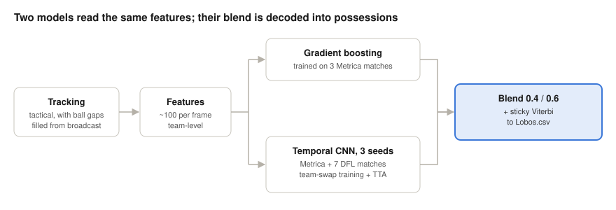
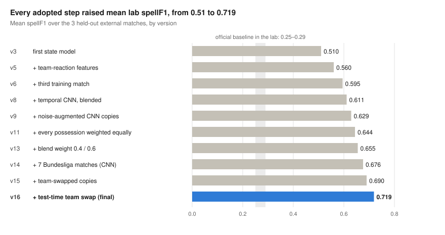

## Summary

For every frame of the match we output `H`, `A` or `D`, using **the automatic tracking only**. The final version
(v16) scores **0.719 spellF1** in a cross-validated lab of external matches. In the same lab the official baseline
scores 0.25–0.29 (officially 0.2433). This is a lab score, not the official one (see *Limitations*).

- **Input.** The provided tactical tracking. Where the tactical tracking loses the ball, we fill the gap from the
  provided broadcast tracking after an automatic time sync. The video, the Smart Tagging and any labels of the
  provided game are not used.
- **Models.** About 100 team-level features per frame feed two models: a gradient-boosted classifier and a
  temporal convolutional network (CNN) that sees ±12 s of context. Their blend (0.4 / 0.6) goes through a
  "sticky" Viterbi decoder, which turns frame-by-frame probabilities into whole possessions and stoppages.
- **Training data.** Other matches only: 3 Metrica Sports sample games and 7 DFL/IDSSE Bundesliga games. Every
  model and parameter was chosen in a lab built from those matches.
- **Reproduction.** `sh make_submission.sh Lobos` rebuilds `Lobos.csv` byte for byte in about 35 minutes on a
  laptop CPU. The expected MD5 is `8aec2cd984100e3921b7c0cb51e18d6d` (git tag `v16-final`).
- **Repository.** <https://github.com/jbesnardrodru-lgtm/mtah2027-team>

## Assets: used, not used, dropped

| asset (provided game) | how we use it |
|--------|----------------------|
| Tactical tracking (ATD) | **Main input.** Positions and speeds of players and ball, frame by frame. Team membership only, no identities. |
| Broadcast tracking (ATD) | **Used to fill ball gaps.** It is synced automatically to the tactical timeline: one time offset per half, found by matching the two ball paths. Its ball fills frames where the tactical ball is missing. |
| Broadcast homography | **Used only for its `valid` flag**, to skip replays and close-ups when syncing (`possession/broadcast_sync.py`). |
| Tactical homography | Not used. `make_submission.sh` only checks that the file is present. |
| Smart Tagging | Not used. No code in the pipeline reads it. |
| Tactical and broadcast video | **Not used in the submitted pipeline.** Two video ball detectors were tried and dropped (see *Tried and dropped* and *Compliance*). |
| Public 5-minute ground truth | Used only to check the pipeline and to understand the possession definition. Never used for training, and not used to choose between versions (see *Compliance*). |
| Published graded windows and second-half kick-off frame (DATA.md, FAQ.md) | Used to write `X` outside the graded halves, and `D` from frame 110,808 to the kick-off at 113,742. |

## Training data (all from other games)

| dataset | source and licence | who labelled it, how | amount | used for |
|-----|--------|--------|-----|----|
| Metrica Sports sample games 1–3 | [github.com/metrica-sports/sample-data](https://github.com/metrica-sports/sample-data), published by Metrica Sports with no formal licence; its README asks users to use the data responsibly and to acknowledge Metrica Sports in public work, which we do here | Event data made by Metrica. **We convert the events into per-frame labels with the rules below**, by code. | 3 matches, ~430,000 frames | both models; the lab |
| DFL / IDSSE open data | Bassek et al., *Sci Data* 12, 195 (2025), CC BY 4.0; downloaded from the `pysport/idsse-data` mirror on Hugging Face (`possession/get_dfl.sh`, called by `make_submission.sh`) | The tracking provider's per-frame flags: `BallStatus = 0` → `D`, otherwise `BallPossession` 1/2 → `H`/`A` | 7 Bundesliga matches, ~1,000,000 frames | the CNN only |

**Nobody in our team hand-labelled anything, on any game.** No human-produced data about the provided game (event
data, corrected tracking, annotations) was used.

## Possession rules we implemented

The training labels for the Metrica games are built by code (`possession/external.py`).
They follow CHALLENGE.md:

- **Dead ball (`D`)** starts when the ball goes out, a foul is given, an offside is called, a goal is scored or a
  half ends. It lasts until the next set piece is taken.
- **Possession** belongs to the team of the last *controlled* action: a pass, a set piece, a recovery or a shot.
- **Loose balls, challenges and deflections do not change possession.** Possession stays with the last team in
  control until the other team makes a controlled action, usually a recovery.
- **Restarts** give possession to the team taking the set piece.

Two more rules are applied when the match is labelled:

- **Minimum stoppage** (in the decoder, `possession/model.py`). A stoppage shorter than 3 s that interrupts live
  play is treated as play the tracking lost, and goes back to the team that had the ball.
- **Second half** (`possession/blend.py`, before decoding). The second half is `D` until its kick-off frame
  (113,742), as published by the organisers in FAQ.md.

We **never write `X` on a graded frame.** Every graded frame gets `H`, `A` or `D`, and only ungraded frames are
`X`.

The DFL flags follow a slightly different convention: more dead time (41–52% of frames, against 25–34% for our
Metrica labels) and more short possessions. That is why the DFL games train only the CNN, where they helped on
every lab match. In the gradient boosting the results were mixed.

## Approach

We chose team-level features from the tracking rather than a video model. The tracking covers every frame. And
because team-level features carry no player identities, a model trained on other matches can be applied to ours.



*Pipeline of the submitted version (v16).*

1. **Features** (~100 per frame, `possession/features.py`). Coordinates are oriented so that the home team always
   attacks the same way. The features include:
   - distance from the ball to each team's nearest players
   - ball speed and visibility, and time since the ball was last seen
   - where the ball was last seen and where it is next seen, and who was near it then
   - team reactions: do the players near the ball turn round, do both teams converge on a loose ball, how do the
     defensive lines and the two blocks move sideways
2. **Gradient boosting** (scikit-learn `HistGradientBoostingClassifier`: up to 300 boosting rounds, learning rate
   0.06, 31 leaves per tree, scikit-learn's default early stopping). Frame-by-frame probabilities of `H`, `A` and `D`, trained on the Metrica games.
3. **Temporal CNN** (dilated 1-D convolutions at 12.5 steps per second, ±12 s receptive field, 3 seeds averaged).
   Trained on the Metrica games plus the 7 DFL games, with two kinds of augmentation:
   - each Metrica match appears in 3 differently degraded copies (noise simulator, below);
   - each copy also appears with the teams exchanged (labels `H` ↔ `A`), so the network learns situations
     rather than one team's habits.
4. **Test-time augmentation.** Each CNN also predicts the match with the teams exchanged, and the two predictions
   are averaged. This uses no labels.
5. **Blend and decoder.** We take 0.4 × gradient boosting + 0.6 × CNN, rounded to 3 decimals. A sticky Viterbi
   decoder then picks the most likely sequence of states. Switching team costs 10, entering or leaving `D` costs
   80, and the minimum-stoppage rule is applied last.

**Every possession counts equally in training** (frame weight = 1 / length of its run). This matches spellF1,
which counts possessions rather than frames. In the lab it raised recovered 2–5 s possessions from 48% to 57%.

## Missing and noisy tracking

The ball is missing on about 41% of graded frames of the tactical tracking, and the tracking has player dropouts
and identity switches. We handle this in four ways:

- **More ball positions.** The synced broadcast ball fills part of the gaps. The ball position is then known on
  about 64% of graded frames.
- **Features that expect gaps.** "Ball not seen", time since last seen, and last-seen/next-seen positions are
  features in their own right. Team-shape and reaction features work without the ball at all.
- **Training on degraded data** (`possession/noise.py`). Before training, the clean external tracking is made to
  look like ours:
  - the ball is removed on about 41% of frames, in long gaps;
  - the ball path is smoothed over 19 frames, and a ~0.6 m drift is added;
  - players are dropped in random blocks, leaving 20.5 of 22 tracked on average.

  The settings come from aggregate statistics of the provided automatic tracking: the missing-ball share, gap
  lengths, ball smoothness and players tracked. No labels and no video were used for them (see *Compliance*).
- **Decoding whole possessions.** The sticky decoder and the minimum-stoppage rule stop a lost ball from
  splitting one possession into many.

## Validation: the lab

- **Cross-validation by match.** We train on two Metrica games, score the third with the official metric code
  (`evaluation/possession_metrics.py`), and rotate. The DFL games are added to the training side of every fold
  and are never scored. The test match is degraded by the same noise simulator.
- **The lab is realistic.** The official baseline scores 0.25–0.29 in the lab, against 0.2433 officially.
- **How we decided.** A change was kept only if it raised the mean lab score without clearly hurting any held-out
  match. Most adopted steps improved all three matches. The two exceptions were v11 (one match −0.006, within
  noise) and v15 (one match −0.007 for the ensemble, but 8 of 9 seed-by-match comparisons better).

## Results



*Lab results from STATUS.md, v3 to v16, mean of 3 held-out Metrica matches.*

| version | what changed | lab spellF1 (mean of 3 held-out matches) |
|------|--------------|----------|
| official baseline | nearest player + majority vote | 0.25–0.29 |
| v3 | first state model | 0.510 |
| v5 | + team-reaction features | 0.560 |
| v6 | + third training match | 0.595 |
| v8 | + temporal CNN, blended | 0.611 |
| v9 | + noise-augmented copies for the CNN | 0.629 |
| v11 | + every possession weighted equally | 0.644 |
| v13 | + blend weight 0.4 / 0.6 | 0.655 |
| v14 | + 7 Bundesliga matches (CNN) | 0.676 |
| v15 | + team-swapped training copies | 0.690 |
| **v16 (submitted)** | **+ test-time team swap** | **0.719** (0.738 / 0.734 / 0.684) |

**Short possessions are the hardest case.** In the lab v16 recovers 31% of possessions shorter than 2 s and 64%
of those between 2 and 5 s.

**On the provided game we can only check consistency, since we have no labels.** These checks were not used to
tune any parameter. They were used once, to reject v17 (see *Tried and dropped*).

| check on the provided game (no labels) | lab | provided game |
|--------------|-----|-----|
| gradient boosting and CNN agree (decoded) | 86–87% | 81% |
| the 3 CNN seeds agree with each other | 88–89% | 89% |
| ball position known | 59% (simulated) | 64% |
| possessions per 90 min | 300–354 | ~300 |
| dead-ball share of graded frames | 25–34% | 35% |

**Public 5-minute window** (frames 11,185–18,684). This is a pipeline check only. We ran it on v12, v14 and v16;
v16 scored spellF1 0.65 (bootstrap 90% interval 0.51–0.77, 17 possessions). It is far too short to rank versions,
and we did not use it to.

## Tried and dropped

| idea | lab result | why dropped |
|-----------|---------|-----------|
| Ball detector trained only on external footage (SoccerTrack, Scott et al. 2022, LGPL-3.0), run on the provided video as input (v17) | 53% recall at 96% precision on a held-out SoccerTrack match; ball known on 75% of graded frames instead of 64% | 75% of the added balls fell in stoppages. Our training data never shows a visible ball during dead time, so the models read it as live play: dead share fell from 35% to 28% and every consistency check got worse. The lab cannot test this. |
| Ball detector fine-tuned on pseudo-labels from the provided video | in our pipeline until v11 | Removed in v12: training on the provided video is not allowed (organisers' clarification of 3 Nov 2026) |
| PFF FC World Cup 2022 tracking (40 matches) in training | gradient boosting 0.545–0.575 vs 0.595; CNN 0.674 vs 0.671 with one match down | different labelling convention; three times the training time |
| DFL games in the gradient boosting | 0.610 vs 0.605, one match −0.039 | mixed across matches (kept for the CNN only) |
| DFL labels rebuilt from DFL events with our rules | 0.556 on two matches (vs 0.605 and 0.620) | DFL event times drift 1–2 s from the tracking |
| Pre-train the CNN on DFL, fine-tune on Metrica | 0.640 vs 0.658 | worse than training on both together |
| Pitch mirrored top/bottom; heavier noise (50% ball missing) | 0.650; 0.647 vs 0.658 | both worse |
| 5 CNN seeds instead of 3 | 0.716 vs 0.719 | no gain |
| Stronger short-possession weight (1 / length^1.5) | 0.654 (CNN only: 0.680) vs 0.719 | more false possessions, fewer short ones found |
| Global time shift of the output; switch costs 5–14 | best at 0 frames and 10 | current setting kept |
| "Ball stays with its carrier" gap filling | 0.571 vs 0.595 | erases the useful "ball not seen" signal |
| PathCRF (Kim et al., KDD 2026, pretrained on DFL) as extra features | team right on 74% of live lab frames (ours 84%); right on only 22% of the short possessions we miss | fails on the same moments, adds no information |
| Two-pass re-decoding; self-training on the test match; 4-model ensemble; turnover-aware decoder | 0.644 (equal); 0.587; 0.592; 0.599 vs 0.595 | no gain |
| A perfect detector of fast balls (> 12 m/s), simulated | 0.593 vs 0.595 | a ball in flight belongs to nobody: not worth building |

## Compliance with the rules

The submitted pipeline learns only from other games and reads the provided game only as input.

- **No hand labels** or human-produced data about the provided game, in any amount.
- **Nothing is trained, fitted or tuned on the ground truth or on the video.** The decoder costs, blend weight,
  minimum stoppage and network settings were all chosen in the external lab.
- **The public 5-minute ground truth** was used to check the pipeline, and to understand what counts as
  possession, as CHALLENGE.md invites. We compared the label statistics of the key with our Metrica and PFF
  labels (`possession/convention.py`), and compared the timing of its changes of possession with ours
  (`possession/convention_timing.py`). We also dropped an early rule ("if the ball goes
  back, it was not a change") because the key contradicts it. The key was never used for training and never used
  to choose between model versions.
- **Label-free checks on the provided game** (model agreement, possession counts, dead share) were used for one
  decision only: not adopting v17.
- **Noise simulator settings.** They come from aggregate statistics of the provided automatic tracking (missing-ball
  share, gap lengths, ball smoothness, players tracked), not from its labels or video, and they shape only the
  external training data. We disclose this so the organisers can judge it.
- **Before the 3 November clarification** our pipeline included a ball detector fine-tuned on frames of the
  provided video, and we watched clips of its output against the video. After the clarification we removed that
  detector (v12) and stopped all such inspection. No parameter of the submitted pipeline came from it.
- **Use of LLMs.** Claude (Anthropic) helped write and debug the code, and ran it on a team member's computer.
  GitHub Copilot and Claude helped draft and edit this document. Our team rule was to share only code, error
  messages and aggregate numbers with them, never tracking rows, video frames or per-frame outputs.

## Reproduction

```
pip install -r requirements-lock.txt     # Python 3.14 (3.14.6 and 3.14.7 tested); exact package versions
# unpack the organisers' data bundle into data/ (not in the repository)
sh make_submission.sh Lobos              # -> evaluation/results/Lobos.csv
```

The script runs these stages:

1. Checks that the data bundle is in `data/`.
2. Downloads the external matches (Metrica sample data and DFL/IDSSE open data, about 2.8 GB).
3. Builds the tracking caches and the broadcast sync.
4. Builds the lab features: 3 degraded copies of each Metrica match, team-swapped copies, and the DFL matches.
5. Trains the gradient boosting and predicts the match.
6. Trains the 3 CNN seeds, each predicting the match as is and team-swapped.
7. Blends and decodes, then runs the official validator and prints the MD5.

**Runtime:** about 35 minutes on a laptop CPU, no GPU.

**Determinism:** fixed seeds, CPU only with a fixed thread count, and probabilities rounded to 3 decimals before
decoding. Every stage is skipped when its output already exists, so an interrupted run resumes.

**Check:** `Lobos.csv` must have MD5 `8aec2cd984100e3921b7c0cb51e18d6d`. Two team members' Macs (Jorge's and
Matteo's, Python 3.14.7 and 3.14.6) produced this same file.

## Limitations and what we would do next

- **Dead ball is our main weakness.** In the public window we mark only 25% of the official stoppage frames as
  `D`. Our training labels end a stoppage when the set piece is taken, and the official key appears to keep more
  frames dead. We could not legitimately measure the difference. With more time, we would use external data
  labelled with the official convention.
- **The lab is easier than the match.** Our models agree less on the provided game (81%) than in the lab
  (86–87%), so the official score is likely below 0.719. The simulator reproduces ball gaps and noise, but not
  identity switches or systematic position errors. Making it more realistic is the next step.
- **Possessions under 2 s are still mostly missed** (31% found in the lab). They are often a single touch with no
  ball position.
- **The ball is unknown on 36% of graded frames, much of it in stoppages.** A detector trained on external footage
  finds many of these balls. But our models would first need training data that shows a visible ball during
  stoppages.

## References

- Metrica Sports sample data: <https://github.com/metrica-sports/sample-data>
- Bassek, M., Rein, R., Weber, H. et al. An integrated dataset of spatiotemporal and event data in elite soccer.
  *Sci Data* 12, 195 (2025). doi:10.1038/s41597-025-04505-y (CC BY 4.0)
- Scott, A. et al. SoccerTrack: a dataset and tracking algorithm for soccer with fish-eye and drone videos. CVPRW
  2022 (LGPL-3.0). Dropped experiment only.
- Kim, H., Lee, K., Seo, S., Ko, S.-K., Yoon, J. and Park, C. PathCRF: Ball-free soccer event detection via
  possession path inference from player trajectories. KDD 2026. Code: github.com/hyunsungkim-ds/pathcrf (MPL-2.0).
  Dropped experiment only.
- PFF FC World Cup 2022 tracking data. Dropped experiment only.
- Software: PyTorch, scikit-learn, NumPy, pandas; kloppy (reference for data formats); Ultralytics YOLO11
  (dropped detector experiments).
